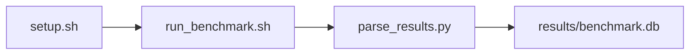

# rocHPL FP64 (High Performance Linpack) Benchmark

[](LICENSE)
[](.github/workflows/ci.yml)

Target: Ubuntu 26.04 · AMD · see Hardware Requirements. This is a host benchmark, not a laptop `pip install` project.

## Quick Start

```bash
git clone https://github.com/garys-gpu-benchmarks/320-gpu-bench-amd-linpack-rochpl-fp64-ubu2604.git
cd 320-gpu-bench-amd-linpack-rochpl-fp64-ubu2604
sudo bash setup.sh --assume-yes
bash run_benchmark.sh --profile smoke --validate
```
Results are written to `results/benchmark.db` and `results/summary.json`.

This workload is executed on the validation host after the repository is copied there. `setup.sh` and `run_benchmark.sh` do not open an outbound SSH session.

Prerequisites: Ubuntu 26.04; AMD; Python 3.14.4; root or sudo for `setup.sh`. Framework: Bash, SQLite, Python, PyYAML, ROCm Runtime, C/C++, HIP/ROCm, HIPCC, rocBLAS, rocSOLVER, Open MPI. This is a host benchmark, not a laptop `pip install` project.



## 1. Overview

Builds local bin/rochpl (rocHPL) with a hipcc GCC pin, then runs mpirun --allow-run-as-root -np num_gpus bin/rochpl with CLI --N --NB --P --Q --pfact. problem_size_N >=65536 is clamped to 32768. num_iterations is capped by timed_repeats (6 at N>=32768 baseline, 16 extended). Residual Check: PASSED is required. Sweep dimensions: num_gpus, process_grid_P, process_grid_Q, precision, problem_size_N, block_size, panel_factorization, warmup_iters.

## 2. What It Validates

- Validates rocHPL GFLOPS, time-to-solution, and Residual Check: PASSED. Residual FAILED aborts
- #1: Mean rocSOLVER LU FP64, TFLOPS (sustained_fp64_performance_across_problem_size_n_tflops); is present and physically sensible.
- #2: Mean rocSOLVER LU time, s (time_to_solution_across_problem_size_n_s); is present and physically sensible.
- #3: Mean percent of full MI300X FP64 matrix peak (percent_of_gpu_fp64_matrix_peak) is present and physically sensible.

## 3. Metrics Captured

- **#1: Mean rocSOLVER LU FP64, TFLOPS** — stored as `sustained_fp64_performance_across_problem_size_n_tflops`.
- **#2: Mean rocSOLVER LU time, s** — stored as `time_to_solution_across_problem_size_n_s`.
- **#3: Mean percent of full MI300X FP64 matrix peak** — stored as `percent_of_gpu_fp64_matrix_peak`.

## 4. Hardware Requirements

### Supported environment

- OS: Ubuntu 26.04
- GPU vendor: AMD
- Framework family: Bash, SQLite, Python, PyYAML, ROCm Runtime, C/C++, HIP/ROCm, HIPCC, rocBLAS, rocSOLVER, Open MPI
- Python: Python 3.14.4

### Reference validation environment

The tables below describe the machine used to generate the reference results. They are not a requirement that every user buy that exact cloud instance.

### System

Ubuntu 26.04 / AMD / Bash, SQLite, Python, PyYAML, ROCm Runtime, C/C++, HIP/ROCm, HIPCC, rocBLAS, rocSOLVER, Open MPI

### GPU

Ubuntu 26.04 / AMD / Bash, SQLite, Python, PyYAML, ROCm Runtime, C/C++, HIP/ROCm, HIPCC, rocBLAS, rocSOLVER, Open MPI

## 5. Software Requirements

| Component | Version |
|---|---|
| OS | Ubuntu 26.04 |
| Kernel | kernel 7.0.0 |
| Python | Python 3.14.4 |
| ROCm | ROCm 7.14 |
| rocBLAS | rocBLAS 5.2.0 |

Builds local bin/rochpl (rocHPL) with a hipcc GCC pin, then runs mpirun --allow-run-as-root -np num_gpus bin/rochpl with CLI --N --NB --P --Q --pfact. problem_size_N >=65536 is clamped to 32768. num_iterations is capped by timed_repeats (6 at N>=32768 baseline, 16 extended).

## 6. Installation

```bash
Build scripts/build.sh under hipcc_host_gcc.sh; run mpirun bin/rochpl with CLI --N --NB --P --Q --pfact. HPL.dat is present but is not the control path
```

## 7. Running the Benchmark

```bash
Build scripts/build.sh under hipcc_host_gcc.sh; run mpirun bin/rochpl with CLI --N --NB --P --Q --pfact. HPL.dat is present but is not the control path
```

**Validating results separately:**

```bash
export BENCHMARK_PYTHON=/usr/bin/python3.13  # optional
python3 -m venv .venv
source ".venv/bin/activate"
".venv/bin/python" scripts/validate_results.py
```

## 8. Output

### `results/benchmark.db` (SQLite)

Local bin/rochpl stdout plus a normalized CSV aggregate. This is not mpirun and not an HPC container log

sample_index,status,sustained_fp64_performance_across_problem_size_n_tflops,percent_of_gpu_fp64_matrix_peak,time_to_solution_across_problem_size_n_s,error_message
0,ok,12.5,7.6,8.4,

```bash
Build scripts/build.sh under hipcc_host_gcc.sh; run mpirun bin/rochpl with CLI --N --NB --P --Q --pfact. HPL.dat is present but is not the control path
```

### `results/summary.json`

Consolidated metrics from the most recent run — suitable for CI artifact upload or dashboard ingestion.

### `results/raw/<timestamp>.txt`

Local bin/rochpl stdout plus a normalized CSV aggregate. This is not mpirun and not an HPC container log

sample_index,status,sustained_fp64_performance_across_problem_size_n_tflops,percent_of_gpu_fp64_matrix_peak,time_to_solution_across_problem_size_n_s,error_message
0,ok,12.5,7.6,8.4,

## 9. Baselines / Thresholds

Expected ranges and gates live in `config/benchmark_config.yaml` under `baselines:` or `thresholds:`. To update them, edit that file — never edit validation code directly.

## 10. Troubleshooting

**`setup.sh` missing collector**
Create cannot finish without `scripts/collect_workload.py`.

**`self_check` overlay rewritten**
Do not overwrite files listed in `results/overlay_lock.json`.

**Remote SSH drop during setup**
Reconnect and resume `bash setup.sh --assume-yes`. Do not wipe `.venv` or `.cache`.

## 11. NVIDIA H100 Coding Differences

Primary target is AMD ROCm. NVIDIA notes in this section are reference only and are not the execution path.

## Repository layout

```text
.
├── setup.sh
├── run_benchmark.sh
├── benchmark_specification.json
├── config/
├── scripts/
├── src/
├── tests/
├── docs/
├── results/
└── LICENSE
```
